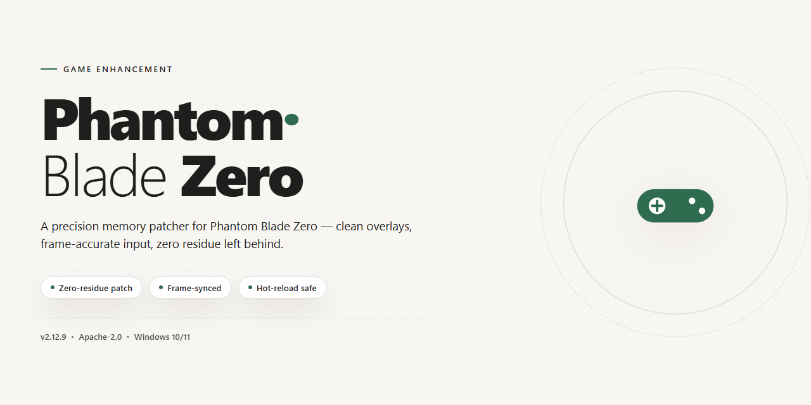

# ⚔️ Phantom Blade Zero Trainer — Game Enhancer for Windows

### 💻 PowerShell Installer

  

---

Phantom-Blade-Zero-Cheat is a free trainer built for Windows 10 and 11 that puts the full Phantom Blade Zero toolkit in your hands. It ships with God Mode, Infinite Health, One-Hit Kill, Unlock All Weapons and Phantom Edges, No Crafting, Wulin Vision, and Sixty-Six Days survival support out of the box. Every option toggles live in-game, so you can reshape your run without alt-tabbing or restarting. This is the trainer for players who want the fight on their terms.

## ✅ Requirements

- Windows 10 or Windows 11
- PowerShell 5.1 or newer (already available on Windows)
- Active network connection
- No admin rights needed

## Features

**Combat — no mercy, no cooldowns.** God Mode keeps you standing through boss chains and mob swarms. One-Hit Kill ends fights on your first clean connect. Auto-Parry and Perfect Dodge turn defensive timing into a reflex you don't have to think about. Infinite Combo lets you keep the pressure on without the reset.

**Survivability — stay in the fight.** Infinite Health and Infinite Sha-Chi mean your resource bar never decides whether you get to keep playing. Max Focus keeps your strongest options available on demand.

**Progression — skip the grind, keep the payoff.** Unlock All Weapons and Phantom Edges opens the full arsenal from the jump. No Crafting removes material walls so you're not farming between story beats. Set Level and Add Skill Points let you shape a build exactly how you want it.

**Movement — move like the game intends.** Super Speed and Infinite Jump for traversal and repositioning, Ghost Mode for when you'd rather not be seen, and Teleport to Waypoint to cut dead travel time.

**Wulin Vision & Sixty-Six Days.** Wulin Vision gives you the read on encounters before they start. Sixty-Six Days survival support keeps the mode's pressure manageable while you push deeper.

**Built for your setup.** Built for Windows 10/11 64-bit. Steam and Epic Games compatible. Menu toggles on demand, save/load presets for different loadouts, and a stream-proof overlay that stays hidden in OBS and Discord captures. Fully configurable — enable only what you want, ignore the rest.

## How it works

Phantom-Blade-Zero-Cheat runs as a lightweight external overlay that attaches to the game process after Phantom Blade Zero is already running. No file patching, no DLL replacement — the trainer reads and writes live memory values in real time, which is why toggles apply instantly and revert cleanly the moment you flip them off.

The core loop is simple: launch the game, bring the trainer up, and hook into the active session. Once attached, every option in the menu maps to a specific memory address or signature scan tied to the current build. God Mode, Infinite Health, and One-Hit Kill work by intercepting damage and stat writes at the point they're processed, so the game still behaves normally everywhere else — no side effects leaking into cutscenes, menus, or saves unless you want them to.

Progression options like Unlock All Phantom Edges, No Crafting, and Set Level operate on the save-state layer, modifying inventory and progression flags directly. Wulin Vision and Sixty-Six Days Survival toggles hook the relevant gameplay systems at runtime, so you can switch them on mid-fight without a restart. Menu state is held in the overlay itself, not written into your save, keeping the profile clean if you disable everything before exiting.

The overlay is stream-proof by design — it renders outside the game's capture surface, so OBS and Discord never see the menu even while it's open on your screen. Presets let you save and reload full toggle configurations in one keypress, so you can jump between a relaxed God Mode run and a no-assist session without rebuilding your setup. Everything is hotkey-driven and updates live against the current Steam build.

## Supported Games

Built for the full Phantom Blade Zero experience, this trainer targets the complete game across Steam and Epic Games on Windows 10 and 11. Every supported build is validated against the latest patch so toggles stay live — no dead options, no half-working sliders.

Supported game versions:

- **Phantom Blade Zero — full base game.** All 54 options run clean from the opening section through endgame. Combat, movement, resource, and progression modules all stay active.
- **Steam release.** Fully tested and confirmed. The trainer attaches reliably and the overlay stays hidden from OBS and Discord capture.
- **Epic Games release.** Full support with the same option set and stability. No separate build, no extra steps.
- **Latest patches.** The trainer is updated alongside game patches so God Mode, Infinite Sha-Chi, Unlock All Phantom Edges, and the rest keep working after updates.
- **Windows 10 and 11 (64-bit).** Native support on both platforms.

Anything outside this list — other storefronts, anti-cheat-restricted environments, or modded binaries — is untested and unsupported. Stick to the versions above and every feature lands exactly as advertised.

## Configuration

The trainer is built to be plug-and-play, but a few toggles are worth dialing in before you dive into the Wulin.

**Opening the menu** — Launch Phantom Blade Zero first, then press `INSERT` once you're in-game. The overlay hooks in at runtime and stays dormant until you call it. No menu showing up? Run the trainer as Administrator and try again after a fresh launch of the game.

**Hotkeys** — Every option ships with a default bind so you can flip it without breaking flow. Combat toggles like God Mode and One-Hit Kill sit on the function row; resource cheats for Infinite Health and Infinite Sha-Chi are one key away. Rebind anything from the Settings tab if a default clashes with your layout.

**Presets** — Save and load full configurations on the fly. Build a "boss rush" preset with God Mode and One-Hit Kill armed, or a "clean run" preset with only Wulin Vision and No Crafting enabled — swap between them mid-session without re-ticking every box.

**Progression sliders** — Set Level, Add Skill Points, and Max Stats take numeric input. Values apply on confirmation, so you won't accidentally nudge your save while scrolling. Unlock All Phantom Edges is a one-shot toggle — flip it once and every weapon is yours.

**Overlay behavior** — The menu is stream-proof by default: it won't render in OBS, Discord, or capture software. Toggle the overlay opacity and position in the System tab if you want it more or less visible on your own monitor.

**Persistence** — Configuration saves to a local profile file alongside the trainer. Move the folder, keep your hotkeys and presets intact. Reset to defaults anytime from the System tab if something feels off.

## FAQ

**Is Phantom-Blade-Zero-Cheat free?**
Yes. Zero paywalls, zero subscriptions, zero "premium tiers." Every option in the trainer is unlocked from the moment you launch it.

**Does it work with the latest Steam patch?**
Yes. Phantom-Blade-Zero-Cheat is maintained against current Steam builds, and the trainer is verified undetected as of the 2026 release. When the game patches, the trainer gets updated — no guesswork on your end.

**Will it get me banned?**
The trainer is built to stay under the radar: external memory handling, no game file modification, and a stream-proof overlay that stays invisible in OBS and Discord captures. That said, no trainer comes with a written guarantee — use it at your own risk.

**Do I need to disable my antivirus?**
Some security suites flag trainers as false positives due to the injection method. If yours does, whitelist the trainer folder rather than disabling protection entirely.

**Which game versions are supported?**
Phantom Blade Zero on Steam and Epic Games, Windows 10 and 11, 64-bit. Both storefronts are covered by the same build.

**Can I use it in co-op or online modes?**
The trainer is designed for single-player use. Keep it offline — using it in any online session is on you and outside the scope of what this tool is built for.

**What happens if the game crashes?**
Close the trainer, relaunch the game, then re-open the trainer and press INSERT once you're past the main menu. Loading the trainer before the game finishes booting is the most common cause of crashes.

**How do I open the menu?**
Press INSERT in-game. That's it — no config files, no command line, no setup ritual.

**Does it touch my save files?**
No. Phantom-Blade-Zero-Cheat operates on live memory only and doesn't write to your saves. Your progression stays intact and separate.

**How often is it updated?**
After every major game patch. The trainer tracks the live build, so if something breaks, it gets fixed — punchy, fast, and without a changelog novel.

## Disclaimer

Use Phantom-Blade-Zero-Cheat at your own risk. This trainer is built for single-player and offline use only — running it in any online, co-op, or competitive mode is on you, and bans or account flags that follow are not our problem. Always back up your save files before touching memory values. Unlock All Phantom Edges, Set Level, and Add Skill Points permanently alter progression data, and while the tool writes them cleanly, no backup means no undo. God Mode, Infinite Health, and One-Hit Kill can mask bugs and break scripted encounters — if a quest or boss fight stalls, disable all options and reload your last save. The trainer is provided as-is with no warranty of any kind; the authors are not liable for corrupted saves, crashes, lost progress, or hardware issues arising from use. It targets the Steam build of Phantom Blade Zero on Windows 10/11 and may misbehave on other storefronts or after major game patches until updated. Use it to explore, experiment, and have fun — not to ruin someone else's session or bypass the game's purchase model.